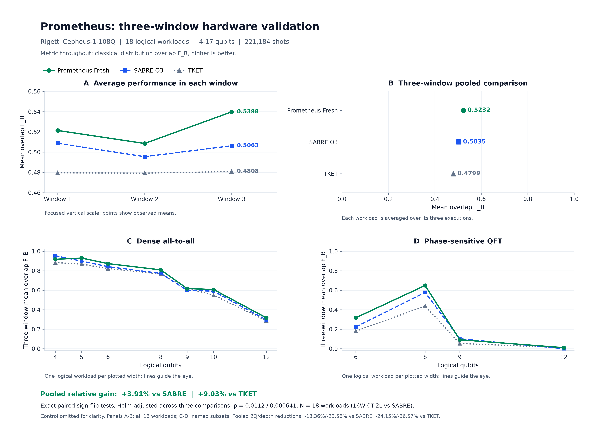
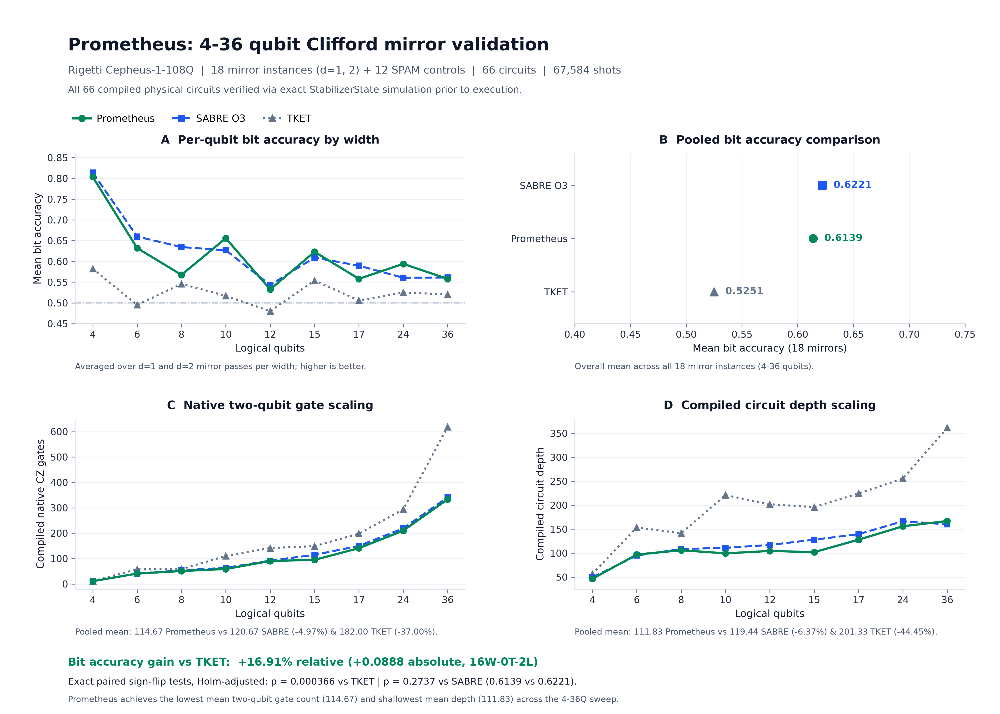
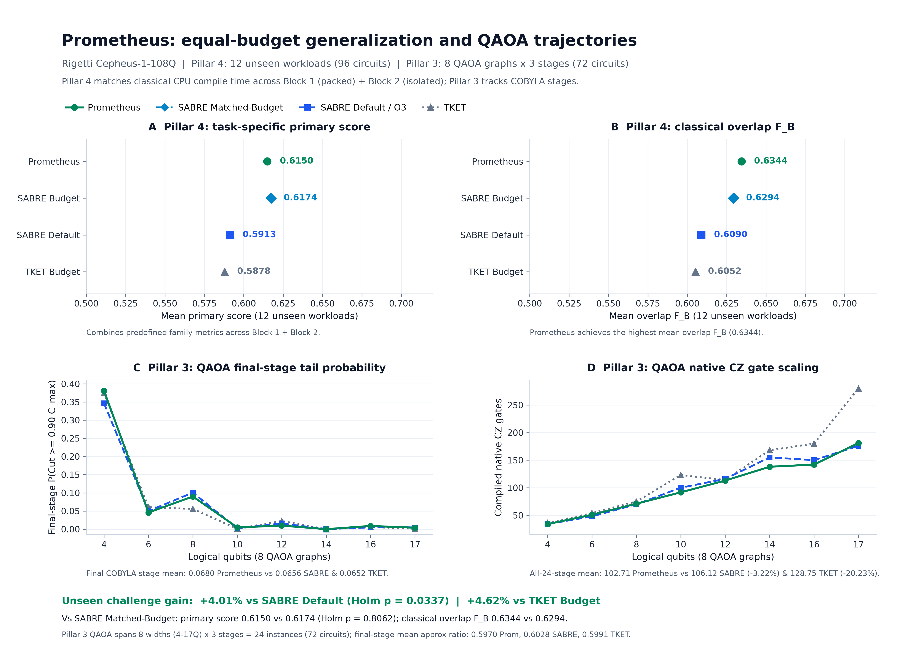
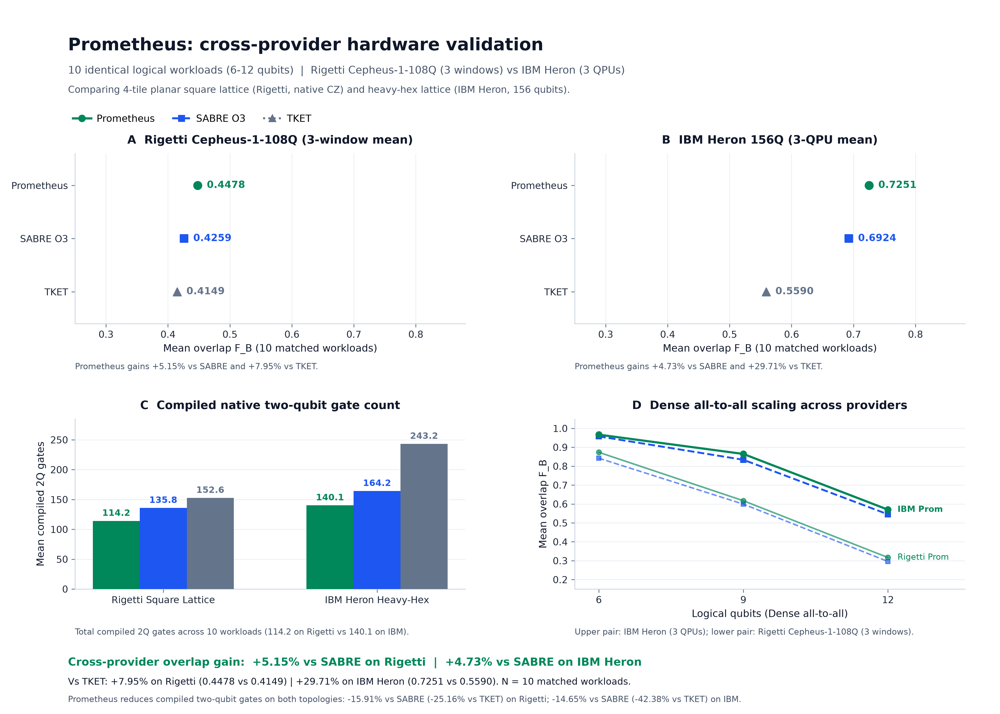

# AWS Braket Multi-Window & 4-Pillar Quantum Compilation Validation (Rigetti Cepheus-1-108Q, 450 Circuits, 460,800 Shots)

[](https://aws.amazon.com/braket/)
[](data/ALL_450_RIGETTI_CIRCUITS_RESULTS.csv)
[](data/ALL_450_RIGETTI_CIRCUITS_RESULTS.csv)
[-10B981?style=flat-square)](scripts/verify_braket_campaign.py)

Offline-auditable hardware dataset, pre-execution SHA-256 commitments, raw measurement histograms, and verification suite for the **3-Calibration-Window, 4-Pillar Hardware Validation Campaign** executed on **Rigetti Cepheus-1-108Q** (`arn:aws:braket:us-west-1::device/qpu/rigetti/Cepheus-1-108Q`, 108-qubit 4-tile planar square-lattice superconducting QPU with native CZ gates and OpenQASM 3.0 `#pragma braket verbatim` execution).

**Total Verified Hardware Scope:** **10 AWS Braket `ProgramSet` Quantum Tasks** | **450 compiled physical circuits** | **460,800 physical shots** (1,024 shots/circuit) | **265.73 s** total task turnaround time | **USD 198.8400** calculated AWS Braket QPU charges.

---

## 1. Executive Summary & Principal Comparative Benchmarks

### Key Empirical Takeaways
- **Pillar 1 - 3-Calibration-Window Longitudinal Replication (3 Tasks, 216 Circuits, 221,184 Shots across W1, W2 +9.3h Drift, and W3 Post-Recalibration):** Across all 18 independent workloads (4Q-17Q) pooled across 3 calibration windows, **Prometheus Fresh** (live calibration) achieved **0.5232 *(mean)* / 0.6125 *(median)*** Classical Overlap F_B (F_H = 0.3723, TVD = 0.6754), improving 3-window workload-averaged F_B by **+3.91%** over **Qiskit SABRE O3** (0.5035, **16W-0T-2L = 88.9%**, Holm Wilcoxon p = 0.00801, Holm permutation p = 0.0112) and by **+9.03%** over **Quantinuum TKET O2** (0.4799, **15W-1T-2L**, Holm Wilcoxon p = 0.00098, Holm permutation p = 0.000641) while cutting native CZ gates by **-13.36%** vs. SABRE (-24.15% vs. TKET) and compiled depth by **-23.56%** vs. SABRE (-36.57% vs. TKET).
- **Live Calibration Adaptation (Window 3 Post-Recalibration):** In Window 3 (after device recalibration), recompiling with live calibration (`Prometheus Fresh`) improved F_B by **+6.61%** over SABRE O3 (0.5398 vs. 0.5063, Holm p = 0.0379), **+12.27%** over TKET (0.4808, Holm p = 0.000938), and **+2.79%** over the frozen Window 1 control circuit (`Prometheus Control` 0.5251).
- **Pillar 2 - 4Q to 36Q Clifford Mirror Suite + SPAM Controls (1 Task, 66 Circuits, 67,584 Shots):** Across 18 mirror instances (4Q-36Q), Prometheus achieved the lowest native CZ gate count (**114.67** vs. 120.67 SABRE O3, **-4.97%**, and 182.00 TKET, **-37.00%**) and shallowest depth (**111.83** vs. 119.44 SABRE O3, **-6.37%**, and 201.33 TKET, **-44.45%**), outperforming TKET on per-qubit bit accuracy by **+16.91%** (0.6139 vs. 0.5251, **16W-0T-2L**, Holm p = 0.000366) and matching SABRE O3 statistically (0.6221, Holm p = 0.2737).
- **Pillar 3 - 4Q to 17Q QAOA Trajectories (1 Task, 72 Circuits, 73,728 Shots):** Across 8 graph widths x 3 COBYLA stages (24 instances), Prometheus achieved the lowest 2Q gates (**102.71** vs. 106.12 SABRE, **-3.22%**, and 128.75 TKET, **-20.23%**) and shallowest depth (**234.75** vs. 248.58 SABRE, **-5.56%**, and 332.75 TKET, **-29.45%**), and achieved the highest final-stage high-quality solution tail probability P(Cut ≥ 0.90 C_max) = **0.0680** (**+3.66%** vs. SABRE 0.0656, **+4.29%** vs. TKET 0.0652).
- **Pillar 4 - 12 Unseen Workloads Under Equal CPU Budget (5 Tasks, 96 Circuits, 98,304 Shots):** Under an identical classical CPU wall-clock budget (mean 2.91 s/circuit), Prometheus achieved the highest Classical Overlap F_B (**0.6344 *(mean)* / 0.6508 *(median)*** vs. 0.6294 / 0.6329 Multi-Seed SABRE Budget, 0.6090 / 0.6382 SABRE Default, and 0.6052 / 0.6427 TKET Budget) and beat Default SABRE O3 by **+4.01%** on primary metrics (9W-0T-3L, 10W-0T-2L on F_B, Holm p = 0.0337).

> [!NOTE]
> **Metric Conventions:**
> - **Classical Bhattacharyya Overlap (F_B (↑)):** F_B = Σ_x √(P_ideal(x) · P_meas(x)) (labeled `"State Fidelity"` in Studio UIs).
> - **Squared Hellinger Fidelity (F_H (↑)):** F_H = F_B². **Heavy-Output Probability (HOP (↑))**, **Total Variation Distance (TVD (↓))**, and **Observed Shannon Entropy (H, bits)** are reported for every cohort. Winning values in each cohort are **bolded**.

### Table 1A: Principal Comparative Benchmark Summary Across All 4 Pillars & 3 Windows (450 Circuits, 460,800 Shots)

| Validation Pillar & Cohort Scope | Compiler Pipeline | Primary Metric *(mean)* (↑) | Classical Overlap F_B *(mean / med)* (↑) | Hellinger F_H *(mean)* (↑) | HOP *(mean)* \| TVD *(mean)* | Entropy H (bits) | CZ Gates \| Depth *(mean)* (↓) | % Delta & Paired Statistical Tests (Holm-Adjusted) |
| :--- | :--- | :---: | :---: | :---: | :---: | :---: | :---: | :--- |
| **Pillar 1 (3-Window Pooled: W1+W2+W3)**<br>3 Tasks, 216 Circs, 221,184 Shots (N = 18, 4Q-17Q) | **Prometheus Fresh (Live Cal.)**<br>Prometheus Control (Topo/Stale)<br>Qiskit SABRE O3<br>Quantinuum TKET O2 | **0.5197**<br>0.5166<br>0.5011<br>0.4801 | **0.5232 / 0.6125**<br>0.5192 / 0.5971<br>0.5035 / 0.5841<br>0.4799 / 0.4941 | **0.3723**<br>0.3691<br>0.3519<br>0.3243 | **0.5770 \| 0.6754**<br>0.5686 \| 0.6775<br>0.5586 \| 0.6916<br>0.5309 \| 0.7196 | 7.8623<br>7.8703<br>7.8846<br>7.9108 | 91.35 \| 148.56<br>**90.63 \| 148.22**<br>105.44 \| 194.35<br>120.44 \| 234.22 | **+3.91% F_B vs. SABRE** (-13.36% CZ / -23.56% Depth)<br>**16W-0T-2L vs. SABRE** (p_{Wilc,Holm} = **0.00801**, p_{perm,Holm} = **0.0112**)<br>**+9.03% F_B vs. TKET** (-24.15% CZ / -36.57% Depth)<br>**15W-1T-2L vs. TKET** (p_{Wilc,Holm} = **0.00098**, p_{perm,Holm} = **0.000641**) |
| **Pillar 1 - Window 1 (Baseline)**<br>Task 1, 72 Circs, 73,728 Shots (N = 18) | Prometheus Fresh (Live W1)<br>**Prometheus Control (Topo-Only)**<br>Qiskit SABRE O3<br>Quantinuum TKET O2 | 0.5166<br>**0.5222**<br>0.5062<br>0.4803 | 0.5214 / 0.5911<br>**0.5245 / 0.6095**<br>0.5088 / 0.5968<br>0.4796 / 0.4913 | **0.3754**<br>0.3744<br>0.3578<br>0.3231 | **0.5844 \| 0.6705**<br>0.5726 \| 0.6717<br>0.5693 \| 0.6881<br>0.5283 \| 0.7194 | 7.8703<br>7.8444<br>7.8790<br>7.9152 | 91.33 \| 148.17<br>**89.17 \| 147.67**<br>105.44 \| 194.17<br>120.44 \| 234.22 | **+2.47% Fresh vs. SABRE** (-13.38% CZ / -23.69% Depth)<br>**+3.08% Ctrl vs. SABRE**<br>**13W-1T-4L vs. SABRE (F_B)** (p_perm = **0.0349**, Holm 0.0699)<br>**15W-0T-3L vs. TKET (F_B)** (p_{perm,Holm} = **0.00204**) |
| **Pillar 1 - Window 2 (+9.3h Drift)**<br>Task 9, 72 Circs, 73,728 Shots (N = 18) | **Prometheus Fresh (Live W2)**<br>Prometheus Control (Frozen W1)<br>Qiskit SABRE O3<br>Quantinuum TKET O2 | 0.5043<br>**0.5053**<br>0.4926<br>0.4805 | **0.5086 / 0.5884**<br>0.5079 / 0.4949<br>0.4955 / 0.5600<br>0.4793 / 0.5042 | 0.3535<br>**0.3565**<br>0.3458<br>0.3253 | **0.5633** \| 0.6922<br>0.5599 \| **0.6860**<br>0.5488 \| 0.6966<br>0.5353 \| 0.7187 | 7.8888<br>7.8799<br>7.8875<br>7.9049 | 91.61 \| 149.78<br>**90.94 \| 148.22**<br>105.44 \| 194.28<br>120.44 \| 234.22 | **+2.63% F_B vs. SABRE** (-13.12% CZ / -22.91% Depth)<br>+2.49% Ctrl vs. SABRE<br>**13W-1T-4L vs. SABRE** (p_perm = 0.1103)<br>**15W-1T-2L vs. TKET** (p_{perm,Holm} = **0.00659**) |
| **Pillar 1 - Window 3 (Post-Recal.)**<br>Task 10, 72 Circs, 73,728 Shots (N = 18) | **Prometheus Fresh (Live W3)**<br>Prometheus Control (Frozen W1)<br>Qiskit SABRE O3<br>Quantinuum TKET O2 | **0.5383**<br>0.5223<br>0.5045<br>0.4797 | **0.5398 / 0.6365**<br>0.5251 / 0.6207<br>0.5063 / 0.5737<br>0.4808 / 0.4867 | **0.3880**<br>0.3765<br>0.3519<br>0.3244 | **0.5833 \| 0.6634**<br>0.5734 \| 0.6748<br>0.5578 \| 0.6901<br>0.5291 \| 0.7205 | 7.8279<br>7.8867<br>7.8872<br>7.9122 | **91.11 \| 147.72**<br>91.78 \| 148.78<br>105.44 \| 194.61<br>120.44 \| 234.22 | **+6.61% F_B vs. SABRE** (-13.59% CZ / -24.09% Depth)<br>**+2.79% F_B vs. Frozen W1 Control**<br>**11W-0T-7L vs. SABRE (F_B)** (p_{perm,Holm} = **0.0379**)<br>**15W-0T-3L vs. TKET** (p_{perm,Holm} = **0.000938**) |
| **Pillar 2 (Clifford Mirrors 4Q-36Q)**<br>Task 2, 66 Circs, 67,584 Shots (18 Mirrors + 12 SPAM) | Prometheus (O3 Cal-Aware)<br>**Qiskit SABRE O3**<br>Quantinuum TKET O2 | 0.2277 Pol<br>**0.2442 Pol**<br>0.0501 Pol | 0.6139 / 0.6078 Acc<br>**0.6221 / 0.6151 Acc**<br>0.5251 / 0.5250 Acc | 0.0904 Surv<br>**0.0907 Surv**<br>0.0192 Surv | 0.2277 \| 0.3861<br>**0.2442 \| 0.3779**<br>0.0501 \| 0.4749 | 6.0367<br>**6.0116**<br>7.0173 | **114.67 \| 111.83**<br>120.67 \| 119.44<br>182.00 \| 201.33 | **+16.91% Bit Acc vs. TKET** (**-37.00% CZ / -44.45% Depth**)<br>-1.31% Bit Acc vs. SABRE (**-4.97% CZ / -6.37% Depth**)<br>**16W-0T-2L vs. TKET** (p_{perm,Holm} = **0.000366**)<br>6W-0T-12L vs. SABRE (p_Holm = 0.2737) |
| **Pillar 3 (QAOA Trajectories 4Q-17Q)**<br>Task 3, 72 Circs, 73,728 Shots (8 Widths x 3 Stages) | Prometheus (O3 Cal-Aware)<br>Qiskit SABRE O3<br>**Quantinuum TKET O2** | 0.5859 Ratio<br>0.5887 Ratio<br>**0.5971 Ratio** | **0.0680** / 0.0093 P_90<br>0.0656 / 0.0103 P_90<br>0.0652 / **0.0142** P_90 | 0.5859<br>0.5887<br>**0.5971** | -0.0736 \| 0.1399<br>**-0.0476 \| 0.1385**<br>-0.1062 \| 0.1508 | 7.8138<br>7.8904<br>**7.9603** | **102.71 \| 234.75**<br>106.12 \| 248.58<br>128.75 \| 332.75 | **+3.66% Final Tail Prob vs. SABRE** (**-3.22% CZ / -5.56% Depth**)<br>**+4.29% Final Tail Prob vs. TKET** (**-20.23% CZ / -29.45% Depth**)<br>Final Approx Ratio: 0.5970 Prom / 0.6028 SABRE / 0.5991 TKET |
| **Pillar 4 (Unseen Equal-CPU-Budget)**<br>Tasks 4-8, 96 Circs, 98,304 Shots (N = 12, 6Q-12Q) | **Prometheus (Equal Budget)**<br>SABRE (O3 Default Seed)<br>**SABRE (O3 Matched Budget)**<br>TKET (O2 Matched Budget) | 0.6150<br>0.5913<br>**0.6174**<br>0.5878 | **0.6344 / 0.6508**<br>0.6090 / 0.6382<br>0.6294 / 0.6329<br>0.6052 / 0.6427 | 0.4448<br>0.4156<br>**0.4465**<br>0.4100 | **0.5982** \| 0.6044<br>0.5595 \| 0.6323<br>0.5948 \| **0.5979**<br>0.5732 \| 0.6316 | 7.9745<br>8.0149<br>7.9596<br>8.0042 | 69.83 \| 153.08<br>77.42 \| 183.08<br>**65.17 \| 146.58**<br>71.58 \| 170.08 | **+4.01% Primary vs. SABRE Default** (-9.80% CZ / -16.39% Depth)<br>**+4.62% Primary vs. TKET Budget** (-2.44% CZ / -10.00% Depth)<br>**9W-0T-3L Primary (10W-0T-2L F_B) vs. SABRE Def** (p_Holm = **0.0337**)<br>5W-0T-7L Primary (**8W-0T-4L F_B, +0.79% F_B**) vs. SABRE Budget |

*(Column Key for Pillars 2-4: In Pillar 2, Primary Metric = Zero-Centered Polarization P = 2 p_bit - 1, F_B = Mean Bit Accuracy p_bit, F_H = Exact Survival, TVD = Mean Hamming Fraction, and H = Mean Hamming Distance in bits. In Pillar 3, Primary/F_H = QAOA Approx. Ratio across all 24 stage instances, F_B = Final-Stage High-Quality Tail Probability P(Cut ≥ 0.90 C_max), HOP = Ideal Gain Retention η, TVD = |r - r_ideal|, and H = Expected Cut E[Cut].)*

<details>
<summary><strong>Expand Table 1B: Complete 10-Task AWS Braket Hardware Ledger & Commitment Timestamp Notes (USD 198.8400)</strong></summary>

| Task # | Batch & Validation Pillar | Window & Task Timestamps (`data/jobs/*.json`) | AWS Braket Quantum Task ARN (`us-west-1`) | Commitment SHA-256 & JSON Timestamp (`data/commitments/*.json`) | Calibration Snapshot SHA-256 | Circuits \| Shots | Turnaround \| Cost |
| :---: | :--- | :---: | :--- | :--- | :---: | :---: | :---: |
| **1** | `Rigetti_Batch1_P1_W1_72circs`<br>(Pillar 1 Core Sweep - Window 1) | Window 1<br>Sub: `2026-11-01T00:07:49.173806Z`<br>Comp: `2026-11-01T00:08:34.294836Z` | `arn:aws:braket:us-west-1:893688540163:quantum-task/2a6b5957-bbf1-43a5-9194-c87da64399bf` | `6a162ea426172daa...`<br>(`2026-11-01T00:56:22.599515Z` *(resume re-serialized)*) | `e1b24e8dc46002d7...` | 72 \| 73,728 | 45.12s \| USD 31.6344 |
| **2** | `Rigetti_Batch2_P2_Mirrors66`<br>(Pillar 2 4Q-36Q Mirrors + SPAM) | Window 1<br>Sub: `2026-11-01T00:11:06.678697Z`<br>Comp: `2026-11-01T00:11:43.753910Z` | `arn:aws:braket:us-west-1:893688540163:quantum-task/eec556a3-2cd0-4eba-8791-4737cee60aa9` | `0dc5881254c1e873...`<br>(`2026-11-01T00:56:23.836577Z` *(resume re-serialized)*) | `e1b24e8dc46002d7...` | 66 \| 67,584 | 37.08s \| USD 29.0232 |
| **3** | `Rigetti_Batch3_P3_QAOA72`<br>(Pillar 3 4Q-17Q QAOA Trajectories) | Window 1<br>Sub: `2026-11-01T00:58:22.948258Z`<br>Comp: `2026-11-01T00:59:07.891070Z` | `arn:aws:braket:us-west-1:893688540163:quantum-task/c9e0645b-739d-4c3c-aee1-739dcbcf48c5` | `658ed6c8e47d3cac...`<br>(`2026-11-01T00:58:22.899503Z`) | `e1b24e8dc46002d7...` | 72 \| 73,728 | 44.94s \| USD 31.6344 |
| **4** | `Rigetti_Batch4_P4_Block1_Packed48`<br>(Pillar 4 Equal-Budget Packed Block 1) | Window 1<br>Sub: `2026-11-01T01:01:50.931473Z`<br>Comp: `2026-11-01T01:02:12.923326Z` | `arn:aws:braket:us-west-1:893688540163:quantum-task/cc7fe5bb-71ac-4d1c-9b2d-02f544ec917b` | `7e4a89d9881decba...`<br>(`2026-11-01T01:01:50.904771Z`) | `e1b24e8dc46002d7...` | 48 \| 49,152 | 21.99s \| USD 21.1896 |
| **5** | `Rigetti_Batch4_P4_Block2_Isolated_sabre_o3_default` | Window 1<br>Sub: `2026-11-01T01:02:50.617613Z`<br>Comp: `2026-11-01T01:02:58.473605Z` | `arn:aws:braket:us-west-1:893688540163:quantum-task/d1caac13-a61b-4c97-862c-f5e0480772cb` | `7e4a89d9881decba...`<br>(`2026-11-01T01:01:50.904771Z`) | `e1b24e8dc46002d7...` | 12 \| 12,288 | 7.86s \| USD 5.5224 |
| **6** | `Rigetti_Batch4_P4_Block2_Isolated_sabre_o3_matched_budget` | Window 1<br>Sub: `2026-11-01T01:03:10.422394Z`<br>Comp: `2026-11-01T01:03:18.630632Z` | `arn:aws:braket:us-west-1:893688540163:quantum-task/bad64742-ead7-49d1-b1de-cf9d47328981` | `7e4a89d9881decba...`<br>(`2026-11-01T01:01:50.904771Z`) | `e1b24e8dc46002d7...` | 12 \| 12,288 | 8.21s \| USD 5.5224 |
| **7** | `Rigetti_Batch4_P4_Block2_Isolated_tket_matched_budget` | Window 1<br>Sub: `2026-11-01T01:03:30.588240Z`<br>Comp: `2026-11-01T01:03:38.930636Z` | `arn:aws:braket:us-west-1:893688540163:quantum-task/92672c37-8631-4e85-ac99-fa95715de8a6` | `7e4a89d9881decba...`<br>(`2026-11-01T01:01:50.904771Z`) | `e1b24e8dc46002d7...` | 12 \| 12,288 | 8.34s \| USD 5.5224 |
| **8** | `Rigetti_Batch4_P4_Block2_Isolated_prometheus_candidate` | Window 1<br>Sub: `2026-11-01T01:03:50.620575Z`<br>Comp: `2026-11-01T01:03:58.401720Z` | `arn:aws:braket:us-west-1:893688540163:quantum-task/8b348409-6ac6-4762-b6b1-7b9fb279ed5f` | `7e4a89d9881decba...`<br>(`2026-11-01T01:01:50.904771Z`) | `e1b24e8dc46002d7...` | 12 \| 12,288 | 7.78s \| USD 5.5224 |
| **9** | `Rigetti_Batch1_P1_W2_72circs`<br>(Pillar 1 Drift Replication - Window 2) | Window 2<br>Sub: `2026-11-01T09:24:21.065270Z`<br>Comp: `2026-11-01T09:25:05.516169Z` | `arn:aws:braket:us-west-1:893688540163:quantum-task/9d4d452d-9e02-4176-a05c-fd06e78237ac` | `2b7eef3352fafbad...`<br>(`2026-11-01T09:24:21.015843Z`) | `4284e80eb3eb5e3e...` | 72 \| 73,728 | 44.45s \| USD 31.6344 |
| **10** | `Rigetti_Batch1_P1_W3_72circs`<br>(Pillar 1 Post-Recalibration - Window 3) | Window 3<br>Sub: `2026-11-01T19:12:22.391992Z`<br>Comp: `2026-11-01T19:13:02.349031Z` | `arn:aws:braket:us-west-1:893688540163:quantum-task/8e797e69-0955-4129-abd0-43997896fcae` | `66983d6dd653072d...`<br>(`2026-11-01T19:12:22.342659Z`) | `bed37417162b375d...` | 72 \| 73,728 | 39.96s \| USD 31.6344 |
| **Total** | **All 4 Pillars & 3 Calibration Windows** | **W1 + W2 + W3** | **10 Verifiable AWS Braket Task ARNs** | **6 Commitment Ledgers** | **3 Snapshots** | **450 \| 460,800** | **265.73s \| USD 198.8400** |

- **Commitment-Timestamp Chronology Note (Tasks 1-2 vs. Tasks 3-10):** For Tasks 3-10 (312 of 450 circuits, including Window 2, Window 3, and all 96 Pillar 4 unseen circuits), `commitment_timestamp_utc` in `data/commitments/*.json` strictly precedes `submission_timestamp_utc` in `data/jobs/*.json`. For Tasks 1 and 2 (`2a6b5957...` submitted at `00:07:49Z` after locking `rigetti_p1_w1_compiled.pkl` at `00:07:49.124Z`, and `eec556a3...` submitted at `00:11:06Z` after locking `rigetti_p2_mirrors_compiled.pkl` at `00:11:06.595Z`), resuming the Window 1 runner at `00:56:22Z` (`--phase w1_all`) loaded the unmodified `00:07Z`/`00:11Z` compiled caches and re-serialized the JSON wrapper timestamps (`00:56:22Z` / `00:56:23Z`) before hitting the completed-task checkpoint skip. Both JSON files are retained unmodified so their SHA-256 digests remain intact.

</details>

---

## 2. Visual Summary & Detailed Per-Workload Ledgers



<details>
<summary><strong>Expand Table 2: Complete Per-Workload 3-Window Mean Ledger Across All 18 Pillar 1 Workloads (4Q-17Q, 216 Circuits, 221,184 Shots)</strong></summary>

| Workload ID | Family (Width) | SABRE O3 F_B (↑) | TKET F_B (↑) | Prom Control F_B (↑) | Prom Fresh F_B (↑) | Prom Fresh F_H = F_B² (↑) | Prom Fresh HOP \| TVD | Prom Fresh H (bits) | Native 2Q (S / T / P) (↓) | Depth (S / T / P) (↓) | % Δ F_B (Prom Fresh vs. SABRE) (↑) |
| :--- | :---: | :---: | :---: | :---: | :---: | :---: | :---: | :---: | :---: | :---: | :---: |
| `bipartite_6q_s260126` | bipartite (6Q) | 0.8044 | 0.7740 | **0.8132** | 0.8098 | 0.6561 | 0.5579 \| 0.4850 | 5.8548 | **36.0 / 36.0 / 36.0** | 82.0 / 81.0 / **51.7** | **+0.67%** |
| `bipartite_9q_s260127` | bipartite (9Q) | 0.7232 | **0.7367** | 0.7256 | 0.7257 | 0.5267 | 0.5329 \| 0.5463 | 8.5089 | **84.0** / 101.0 / 87.0 | 122.3 / 182.0 / **111.3** | **+0.33%** |
| `bipartite_12q_s260128` | bipartite (12Q) | 0.3068 | 0.3327 | 0.3177 | **0.3333** | 0.1113 | 0.5072 \| 0.8330 | 9.7423 | 159.0 / 250.0 / **153.0** | 171.0 / 357.0 / **155.3** | **+8.64%** |
| `bipartite_15q_s260131` | bipartite (15Q) | 0.1420 | 0.1368 | 0.1453 | **0.1485** | 0.0220 | 0.5592 \| 0.9633 | 9.9574 | 121.0 / 155.0 / **117.3** | **141.7** / 242.0 / 148.7 | **+4.57%** |
| `dense_4q_s260024` | dense (4Q) | **0.9553** | 0.8845 | 0.9421 | 0.9178 | 0.8430 | 0.6660 \| 0.2894 | 3.7842 | 12.0 / 12.0 / **11.3** | 46.0 / 47.0 / **32.3** | -3.92% |
| `dense_5q_s260025` | dense (5Q) | 0.8992 | 0.8683 | 0.9277 | **0.9308** | 0.8663 | 0.7500 \| 0.2821 | 4.6009 | 18.0 / 19.0 / **17.3** | 50.0 / 50.0 / **44.7** | **+3.51%** |
| `dense_6q_s260026` | dense (6Q) | 0.8423 | 0.8231 | 0.8689 | **0.8735** | 0.7635 | 0.6006 \| 0.3837 | 5.8162 | 64.0 / 69.0 / **44.0** | 150.0 / 133.0 / **78.0** | **+3.70%** |
| `dense_8q_s260028b` | dense (8Q) | 0.7730 | 0.7667 | **0.8218** | 0.8092 | 0.6557 | 0.5518 \| 0.4747 | 7.6803 | 58.0 / 67.0 / **53.3** | **93.0** / 128.0 / 117.0 | **+4.69%** |
| `dense_9q_s260027` | dense (9Q) | 0.5993 | **0.6202** | 0.6191 | 0.6173 | 0.3812 | 0.4906 \| 0.6542 | 8.4806 | 166.0 / 184.0 / **129.0** | 270.0 / 293.0 / **167.0** | **+3.01%** |
| `dense_10q_s260030` | dense (10Q) | 0.5906 | 0.5501 | 0.5989 | **0.6077** | 0.3701 | 0.5299 \| 0.6379 | 9.0553 | 97.0 / 105.0 / **67.0** | 178.3 / 172.0 / **105.0** | **+2.90%** |
| `dense_12q_s260028` | dense (12Q) | 0.2959 | 0.2876 | **0.3269** | 0.3169 | 0.1008 | 0.4974 \| 0.8422 | 9.7513 | 308.0 / 367.0 / **194.0** | 414.0 / 451.0 / **156.3** | **+7.11%** |
| `ising_17q_s260333` | ising (17Q) | 0.0343 | 0.0359 | 0.0355 | **0.0385** | 0.0016 | 0.6182 \| 0.9910 | 9.9857 | **111.0** / 138.0 / 114.3 | **403.0** / 559.0 / 403.3 | **+12.09%** |
| `qaoa_8q_s260428b` | qaoa (8Q) | 0.8330 | 0.8092 | 0.8310 | **0.8389** | 0.7039 | 0.5332 \| 0.4347 | 7.7234 | **59.0** / 69.0 / 61.7 | **154.3** / 208.0 / 160.3 | **+0.71%** |
| `qaoa_12q_s260428` | qaoa (12Q) | 0.3620 | 0.3308 | 0.3760 | **0.3819** | 0.1462 | 0.5426 \| 0.8195 | 9.7111 | 99.0 / 105.0 / **96.0** | 198.7 / 169.0 / **115.7** | **+5.50%** |
| `qft_phase_6q_s260526` | qft_phase (6Q) | 0.2230 | 0.1794 | 0.2973 | **0.3174** | 0.1204 | 0.6702 \| 0.8796 | 5.3643 | 53.0 / **48.0** / 53.7 | 123.0 / 146.0 / **122.0** | **+42.34%** |
| `qft_phase_8q_s260528b` | qft_phase (8Q) | 0.5776 | 0.4381 | 0.5953 | **0.6489** | 0.4240 | 0.7087 \| 0.6486 | 7.3004 | 64.0 / 77.0 / **60.0** | 177.0 / 221.0 / **138.3** | **+12.34%** |
| `qft_phase_9q_s260527` | qft_phase (9Q) | **0.1020** | 0.0536 | 0.0778 | 0.0919 | 0.0085 | 0.5544 \| 0.9915 | 8.4759 | **125.0** / 129.0 / **125.0** | **248.0** / 317.0 / **248.0** | -9.90% |
| `qft_phase_12q_s260528` | qft_phase (12Q) | 0.0000 | 0.0104 | **0.0251** | 0.0104 | 0.0003 | 0.5153 \| 0.9997 | 9.7288 | 264.0 / 237.0 / **224.3** | 476.0 / 460.0 / **319.0** | +0.00% |
| **18-Workload Pooled Mean** | **All 5 Families (4Q-17Q)** | **0.5035** | **0.4799** | **0.5192** | **0.5232** | **0.3723** | **0.5770 \| 0.6754** | **7.8623** | 105.44 / 120.44 / **91.35** | 194.35 / 234.22 / **148.56** | **+3.91%** (16W-0T-2L, p_{perm,Holm} = **0.0112**) |

</details>





<details>
<summary><strong>Expand Table 3: Pillar 4 Unseen Workload Generalization Ledger (Block 1 + Block 2 Combined, 12 Workloads, 6Q-12Q, 96 Circuits)</strong></summary>

| Unseen Workload ID | Family (Width) | CPU Budget | SABRE Def Primary / F_B (↑) | SABRE Bud Primary / F_B (↑) | TKET Bud Primary / F_B (↑) | Prometheus Primary / F_B (↑) | Prom F_H \| HOP \| TVD \| H | Native 2Q (S_Def / S_Bud / T_Bud / Prom) (↓) | Depth (S_Def / S_Bud / T_Bud / Prom) (↓) |
| :--- | :---: | :---: | :---: | :---: | :---: | :---: | :---: | :---: | :---: |
| `fresh_bipartite_8q_s20261440` | bipartite (8Q) | 1.95s | 0.8303 / 0.8303 | **0.8641 / 0.8641** | 0.7669 / 0.7669 | 0.8617 / 0.8617 | 0.7425 \| 0.6621 \| 0.3827 \| 7.3620 | 28 / **22** / 32 / **22** | 56 / **41** / 76 / **41** |
| `fresh_bipartite_12q_s20261506` | bipartite (12Q) | 3.33s | 0.4001 / 0.4001 | 0.4262 / 0.4262 | 0.4259 / 0.4259 | **0.4289 / 0.4289** | 0.1840 \| 0.5684 \| 0.7574 \| 9.6870 | 79 / **52** / 91 / **52** | 112 / **65** / 168 / **65** |
| `fresh_dense_6q_s20261407` | dense (6Q) | 1.79s | 0.8211 / 0.8211 | **0.9470 / 0.9470** | 0.8997 / 0.8997 | 0.9011 / 0.9011 | 0.8120 \| 0.6216 \| 0.3324 \| 5.7694 | 28 / **23** / 27 / 27 | 64 / **55** / 78 / 73 |
| `fresh_dense_10q_s20261473` | dense (10Q) | 4.87s | 0.6423 / 0.6423 | 0.6468 / 0.6468 | **0.6575 / 0.6575** | 0.6559 / 0.6559 | 0.4304 \| 0.5659 \| 0.5791 \| 9.0128 | 97 / **67 / 67 / 67** | 175 / 100 / **97** / 104 |
| `fresh_qaoa_6q_s20261207` | qaoa (6Q) | 1.95s | 0.6700 / **0.9044** | **0.6909** / 0.8927 | 0.6853 / 0.8951 | 0.6842 / 0.8838 | 0.7812 \| 0.4980 \| 0.3804 \| 5.8597 | 52 / **50 / 50 / 50** | 145 / **143** / 144 / 149 |
| `fresh_qaoa_8q_s20261226` | qaoa (8Q) | 2.46s | 0.6145 / 0.7944 | **0.6258** / 0.7764 | 0.6180 / 0.8057 | 0.6153 / **0.8144** | 0.6632 \| 0.5522 \| 0.4684 \| 7.7354 | 83 / **77** / 78 / 83 | 203 / 178 / **171** / 177 |
| `fresh_qaoa_10q_s20261245` | qaoa (10Q) | 3.12s | 0.6010 / 0.6341 | **0.6011** / 0.6191 | 0.5941 / 0.6280 | 0.5893 / **0.6456** | 0.4170 \| 0.5347 \| 0.5940 \| 9.1224 | 106 / **99 / 99** / 102 | 287 / 263 / 264 / **254** |
| `fresh_qaoa_12q_s20261264` | qaoa (12Q) | 3.70s | **0.6102** / 0.3756 | 0.6079 / 0.3816 | 0.6054 / 0.3829 | 0.6051 / **0.3835** | 0.1473 \| 0.5151 \| 0.8019 \| 9.6967 | 135 / **119** / 127 / 137 | 335 / **284** / 307 / 301 |
| `fresh_qft_6q_s20261307` | qft (6Q) | 1.80s | 0.7215 / 0.7215 | **0.8041 / 0.8041** | 0.6659 / 0.6659 | 0.7205 / 0.7205 | 0.5194 \| 0.7197 \| 0.5971 \| 5.5436 | 41 / **36** / 39 / 41 | 97 / **89** / 109 / 97 |
| `fresh_qft_8q_s20261332` | qft (8Q) | 2.52s | 0.5994 / 0.5994 | 0.5883 / 0.5883 | 0.4733 / 0.4733 | **0.6256 / 0.6256** | 0.3914 \| 0.7007 \| 0.6601 \| 7.2380 | 64 / **56** / 61 / 60 | 179 / **130** / 161 / 139 |
| `fresh_qft_10q_s20261357` | qft (10Q) | 3.56s | 0.3568 / 0.3568 | 0.3660 / 0.3660 | **0.4518 / 0.4518** | 0.4166 / 0.4166 | 0.1736 \| 0.6196 \| 0.8204 \| 9.0102 | 94 / **78** / 80 / 90 | 237 / **183** / 199 / 202 |
| `fresh_qft_12q_s20261382` | qft (12Q) | 3.89s | 0.2281 / 0.2281 | 0.2404 / 0.2404 | 0.2098 / 0.2098 | **0.2755 / 0.2755** | 0.0759 \| 0.6201 \| 0.8790 \| 9.6564 | 122 / **103** / 108 / 107 | 307 / **228** / 267 / 235 |
| **12-Workload Mean** | **All 3 Families (6Q-12Q)** | **2.91s** | 0.5913 / 0.6090 | **0.6174** / 0.6294 | 0.5878 / 0.6052 | 0.6150 / **0.6344** | 0.4448 \| **0.5982** \| 0.6044 \| 7.9745 | 77.42 / **65.17** / 71.58 / 69.83 | 183.08 / **146.58** / 170.08 / 153.08 |

</details>

---

## 3. Cross-Provider Architectural Comparison: Rigetti Cepheus-1-108Q vs. IBM Quantum Heron (10 Identical Workloads)



| Shared Workload ID | Family (Width) | Rigetti 3W F_B SABRE (↑) | Rigetti 3W F_B TKET (↑) | Rigetti 3W F_B Prom Fresh (↑) | IBM Heron 3-QPU F_B SABRE (↑) | IBM Heron 3-QPU F_B TKET (↑) | IBM Heron 3-QPU F_B Prometheus (↑) | Rigetti 2Q (S / T / P) (↓) | IBM Heron 2Q (S / T / P) (↓) |
| :--- | :---: | :---: | :---: | :---: | :---: | :---: | :---: | :---: | :---: |
| `dense_6q_s260026` | dense (6Q) | 0.8423 | 0.8231 | **0.8735** | 0.9577 | 0.8559 | **0.9668** | 64.0 / 69.0 / **44.0** | 79.0 / 94.0 / **68.0** |
| `dense_9q_s260027` | dense (9Q) | 0.5993 | **0.6202** | 0.6173 | 0.8339 | 0.8130 | **0.8647** | 166.0 / 184.0 / **129.0** | 210.0 / 252.0 / **173.0** |
| `dense_12q_s260028` | dense (12Q) | 0.2959 | 0.2876 | **0.3169** | 0.5454 | 0.3164 | **0.5700** | 308.0 / 367.0 / **194.0** | 339.0 / 619.0 / **291.7** |
| `bipartite_6q_s260126` | bipartite (6Q) | 0.8044 | 0.7740 | **0.8098** | 0.9647 | 0.9385 | **0.9722** | **36.0 / 36.0 / 36.0** | 48.0 / 54.0 / **46.0** |
| `bipartite_9q_s260127` | bipartite (9Q) | 0.7232 | **0.7367** | 0.7257 | 0.8680 | 0.7818 | **0.8894** | **84.0** / 101.0 / 87.0 | 141.0 / 227.0 / **116.0** |
| `bipartite_12q_s260128` | bipartite (12Q) | 0.3068 | 0.3327 | **0.3333** | **0.5920** | 0.4459 | 0.5896 | 159.0 / 250.0 / **153.0** | **142.0** / 355.0 / 142.7 |
| `qft_phase_6q_s260526` | qft_phase (6Q) | 0.2230 | 0.1794 | **0.3174** | 0.7544 | 0.4746 | **0.7897** | 53.0 / **48.0** / 53.7 | 58.0 / 57.0 / **46.0** |
| `qft_phase_9q_s260527` | qft_phase (9Q) | **0.1020** | 0.0536 | 0.0919 | 0.4927 | 0.3330 | **0.6236** | **125.0** / 129.0 / **125.0** | 175.0 / 171.0 / **145.0** |
| `qft_phase_12q_s260528` | qft_phase (12Q) | 0.0000 | **0.0104** | **0.0104** | 0.3309 | 0.1031 | **0.4067** | 264.0 / 237.0 / **224.3** | 312.0 / 405.0 / **235.0** |
| `qaoa_12q_s260428` | qaoa (12Q) | 0.3620 | 0.3308 | **0.3819** | **0.5842** | 0.5281 | 0.5785 | 99.0 / 105.0 / **96.0** | **138.0** / 198.0 / **138.0** |
| **10-Workload Mean** | **4 Families (6Q-12Q)** | **0.4259** | **0.4149** | **0.4478** | **0.6924** | **0.5590** | **0.7251** | 135.80 / 152.60 / **114.20** | 164.20 / 243.20 / **140.14** |

---

## 4. Verification Protocol & Repository Structure

- **Pre-Dispatch Equivalence Verification:** All non-Clifford circuits traversing ≤ 20 active physical wires were verified before dispatch for exact statevector equivalence (max_x |P_ideal(x) - P_compiled(x)| < 10⁻⁶ under physical measurement wire remapping); larger 14Q-17Q instances traversing > 20 active physical wires enforced 1-to-1 measurement bijection, zero post-measurement ops, and native basis-gate compliance (`rx`, `rz`, `cz`, `measure`). All 66 Clifford mirror and SPAM circuits (4Q-36Q) were verified via exact `StabilizerState` simulation.
- **One-Command Raw-Histogram Audit (450/450 Circuits):** [`scripts/verify_braket_campaign.py`](scripts/verify_braket_campaign.py) verifies all file checksums in [`REPOSITORY_SHA256SUMS.txt`](REPOSITORY_SHA256SUMS.txt), audits task ARNs and timestamps, and recomputes every circuit's score directly from the 450 raw hardware bitstring histograms (`pub_counts` in `data/jobs/*.json`) and logical references in `data/logical_circuits/`:

```bash
python scripts/verify_braket_campaign.py
```

```text
AWS-Braket-Multi-Window-Validation/
├── README.md                                               # Executive summary, benchmark tables, and visual plots
├── PUBLIC_DISCLOSURE.md                                    # IP protection boundary & empirical provenance statement
├── DATA_DICTIONARY.md                                      # Complete column-by-column schema reference
├── REPOSITORY_SHA256SUMS.txt                               # LF-normalized SHA-256 manifest of all tracked files
├── assets/                                                 # 300-DPI PNG and vector PDF visualizations
├── data/
│   ├── ALL_450_RIGETTI_CIRCUITS_RESULTS.csv                # Master 450-row circuit ledger (zero placeholder cells)
│   ├── CROSS_PROVIDER_RIGETTI_VS_IBM_HERON_10WORKLOADS.csv # 10-workload Rigetti vs. IBM Heron comparison table
│   ├── calibration_snapshots/                              # Live Rigetti Cepheus-1-108Q calibration snapshots (W1, W2, W3)
│   ├── commitments/                                        # Pre-execution SHA-256 commitment ledgers (6 batches)
│   ├── jobs/                                               # Raw AWS Braket task payloads & bitstring histograms (10 tasks)
│   ├── logical_circuits/                                   # Unrouted .qasm circuits, .npz ideal distributions, & target specs
│   └── results/                                            # Scored JSON ledgers & 3-window statistical summary
└── scripts/
    └── verify_braket_campaign.py                           # Standalone raw-histogram & statistical audit script (numpy + scipy)
```
